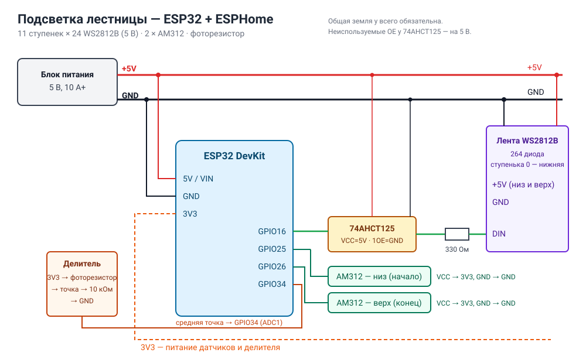

# LEDstairs — подсветка лестницы

Подсветка ступенек адресной лентой по датчикам движения. Ступеньки загораются волной в ту сторону, куда идёт человек, и гаснут через заданное время. В темноте на крайних ступеньках горит слабый ночник.

Основа — проект [AlexGyver «Подсветка лестницы»](https://alexgyver.ru/ledstairs/) с доработками Геннадия Дегтерёва (v1.1–v1.2).

В репозитории две версии прошивки:

| | [ESPHome](esphome/) — **основная** | [Arduino](firmware/) — исходная |
|---|---|---|
| Контроллер | Lolin S2 Mini (ESP32-S2), ESP32 или ESP8266 | Arduino Nano |
| Home Assistant | датчики, свет, настройки, события | — |
| Настройки | из HA, без перепрошивки | в коде, через перепрошивку |
| Индикация (сигналы на лестницу из HA / Node-RED) | ✅ | — |
| Обновление | по Wi-Fi | по USB |
| Работа без сети | ✅ | ✅ |

## ESPHome-версия

Вся логика Arduino-версии сохранена, и добавлено:

- **Датчики «Движение внизу» и «Движение наверху»** в Home Assistant — для своих автоматизаций.
- **Событие «Проход»** со значением `up` или `down`: кто-то пошёл наверх или вниз.
- **Освещённость** с фоторезистора, а порог темноты настраивается из HA.
- **Свет «Подсветка»**: вкл/выкл, цвет и яркость; выбор эффекта: Цвет, Радуга, Огонь, По очереди.
- **Индикация.** Действие `esphome.stairs_led_notify` выводит на лестницу сигнал: «дыхание», мигание, тревогу, бегущую комету, шкалу уровня или отдельные ступеньки. Это удобно для звонка в дверь, напоминаний, прогресса и тревог.
- **Тест на ПК** без железа: сценарий с автоматическими проверками.

👉 **[Документация, схема, установка и примеры](esphome/README.md)**



Конфигурация под лестницу: 11 ступенек × 24 диода WS2812B (5 В). Под другую лестницу меняются две константы в `esphome/stairs_logic.h`.

## Arduino-версия (исходная)

Папка [`firmware/`](firmware/) — прошивки v1.0–v1.2 для Arduino Nano, библиотеки лежат в [`libraries/`](libraries/), схема — в [`schemes/scheme.jpg`](schemes/scheme.jpg).

> **Внимание:** для WS2811 количество чипов = количество светодиодов / 3.

<details>
<summary>Настройки прошивки 1.2 (нажми, чтобы развернуть)</summary>

### Фоторезистор

Автоматическое включение и отключение по освещённости (включено по умолчанию):

```c
#define AUTO_BRIGHT 1     // авто яркость вкл(1) / выкл(0) (с фоторезистором)
```

Текущее показание видно в Serial Monitor (9600 бод) каждые 3 секунды:

```
Photo resistor 789
```

Порог отключения подбирается под свои показания:

```c
#define NIGHT_PHOTO_MAX 500   // при освещении выше этого подсветка полностью отключается
```

### Разное количество диодов на ступеньку

```c
#define STRIP_LED_AMOUNT 256  // кол-во чипов WS2811/WS2812 на всех ступеньках
#define STEP_AMOUNT 16        // количество ступенек

Step steps[STEP_AMOUNT] = {
{ 16, 0b0100100100100100 },   // первая ступенька 16 чипов, каждый третий чип активен в ночном режиме
{ 16, 0b0000000000000000 },   // вторая ступенька 16 чипов, не активна в ночном режиме
...
};
```

Второе поле — битовая маска ночной подсветки: нули — ступенька не светится, единицы — светятся соответствующие диоды.

### Сенсорная кнопка переключения эффектов

```c
#define BUTTON  0        // вкл(1)/выкл(0)
#define BUTTON_PIN 6     // пин кнопки
```

### Ночной режим (с v1.1)

Подсвечиваются крайние ступеньки, маска инвертируется каждые 60 секунд, чтобы диоды не выгорали.

```c
#define NIGHT_LIGHT_COLOR mCOLOR(WHITE)  // цвет
#define NIGHT_LIGHT_BRIGHT 10            // 0 - 255
```

Цвет задаётся функциями microLED: `mCOLOR(WHITE)` (а также SILVER, GRAY, RED, ORANGE, YELLOW, GREEN, AQUA, BLUE, MAGENTA и др.), `mRGB(r, g, b)`, `mWHEEL(0–1530)`, `mHEX(0xRRGGBB)`, `mHSV(h, s, v)`.

### Таймаут

Включение — по любому из датчиков, выключение — только по таймеру. Каждое новое срабатывание любого датчика сбрасывает таймер, поэтому несколько человек на лестнице не останутся в темноте.

### Подсветка перил (по умолчанию выключена)

```c
#define RAILING 0               // вкл(1)/выкл(0)
#define RAILING_LED_AMOUNT 50   // чипов WS2811 на ленте перил
#define RAILING_PIN 11          // пин ленты перил
```

Лента перил делится на столько же сегментов, сколько ступенек, и повторяет эффект соответствующей ступеньки.

</details>

## Структура репозитория

```
esphome/                ESPHome-версия (S2 Mini / ESP32 / ESP8266)
  stairs-led.yaml       конфиг устройства
  stairs_logic.h        движок: волна, эффекты, ночник, индикация
  secrets.example.yaml  какие секреты нужны
  test/                 прогон логики на ПК
  README.md             документация
firmware/               Arduino-прошивки v1.0–v1.2
libraries/              библиотеки для Arduino (microLED, FastLED, GyverButton)
schemes/                схемы: scheme.jpg (Arduino), esp32_wiring.svg (S2 Mini)
```

## Авторы

- Исходный проект: [AlexGyver](https://alexgyver.ru/ledstairs/), 2019 — [github.com/AlexGyver/LEDstairs](https://github.com/AlexGyver/LEDstairs)
- Версии 1.1–1.2: Геннадий Дегтерёв — gennadij@degterjow.de
- ESPHome-версия и индикация для Home Assistant: BIvanS, 2026

Лицензия — см. [LICENSE](LICENSE).
