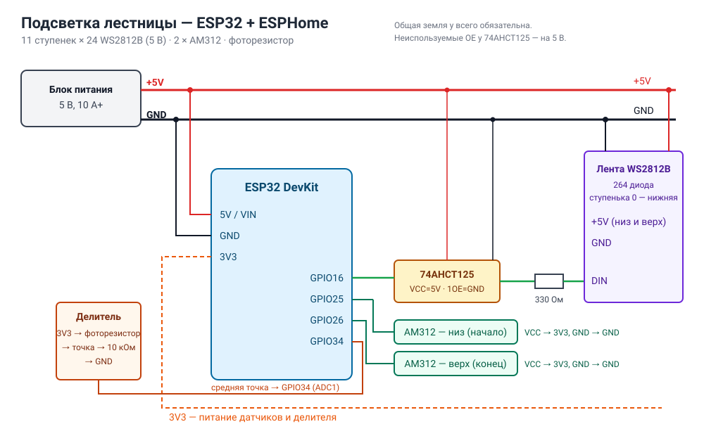

# Подсветка лестницы на ESPHome

Версия проекта для **ESP32 / ESP8266 + ESPHome**. Логика взята из Arduino-прошивки v1.2 из этого же репозитория:

- волна по ступенькам в сторону движения;
- таймаут, который продлевается при каждом срабатывании любого датчика;
- ночная подсветка крайних ступенек со сдвигом маски раз в минуту, чтобы диоды не выгорали;
- работа только в темноте по фоторезистору;
- эффекты «Цвет», «Радуга», «Огонь» и их смена по кругу.

Что добавлено к старой прошивке:

- все датчики и настройки видны в **Home Assistant**, их можно использовать в автоматизациях;
- лестницу можно использовать как **индикатор** и выводить на неё сигналы из HA или Node-RED;
- обновление прошивки по Wi-Fi.

> [!IMPORTANT]
> Вся логика работает на самом контроллере. Если упадёт Wi-Fi или Home Assistant, лестница продолжит включаться по движению, как раньше.



## Содержание

- [Файлы](#файлы)
- [Железо](#железо)
- [Подключение](#подключение)
- [Установка](#установка)
- [Сущности в Home Assistant](#сущности-в-home-assistant)
- [Индикация](#индикация)
- [Примеры автоматизаций](#примеры-автоматизаций)
- [Настройка под свою лестницу](#настройка-под-свою-лестницу)
- [ESP8266 вместо ESP32](#esp8266-вместо-esp32)
- [Тест на ПК](#тест-на-пк)
- [Если что-то не работает](#если-что-то-не-работает)

## Файлы

| Файл | Назначение |
|---|---|
| `stairs-led.yaml` | конфиг устройства ESPHome: пины, сущности, действия API |
| `stairs_logic.h` | движок на C++: волна, эффекты, ночник, индикация |
| `secrets.example.yaml` | какие секреты нужны в `secrets.yaml` |
| `test/` | прогон логики на ПК без железа (см. [Тест на ПК](#тест-на-пк)) |

## Железо

| Компонент | Кол-во | Примечание |
|---|---|---|
| ESP32 DevKit (ESP-WROOM-32) | 1 | или ESP8266 D1 mini, см. ниже |
| Лента WS2812B, 5 В | 264 диода | 11 ступенек × 24 |
| Датчик движения AM312 | 2 | низ и верх лестницы |
| Фоторезистор + резистор 10 кОм | 1 + 1 | делитель для освещённости |
| 74AHCT125 (или 74AHCT1G125) | 1 | поднимает сигнал 3,3 В до 5 В для ленты |
| Резистор 330 Ом | 1 | в линию DATA, у входа ленты |
| Блок питания 5 В | 1 | 10 А и больше |

> [!WARNING]
> 264 диода на полном белом потребляют до ~16 А. На практике при проходе лестницы хватает 10 А. Питание нужно подавать на **оба конца** ленты, внизу и наверху, иначе верхние ступеньки будут тусклее и желтее.

## Подключение

| От | К | Примечание |
|---|---|---|
| БП +5 В | лента +5V (низ и верх), ESP32 **5V/VIN**, 74AHCT125 VCC (14) | |
| БП GND | лента GND, ESP32 GND, 74AHCT125 GND (7) | общая земля обязательна |
| ESP32 **GPIO16** | 74AHCT125 1A (2); 1Y (3) → 330 Ом → DIN ленты | 1OE (1) — на GND; OE (4, 10, 13) — на 5 В |
| ESP32 **GPIO25** | OUT датчика AM312 **внизу** («начало лестницы») | VCC датчика — **3V3** |
| ESP32 **GPIO26** | OUT датчика AM312 **наверху** («конец лестницы») | VCC датчика — **3V3** |
| ESP32 **GPIO34** | средняя точка делителя: 3V3 → фоторезистор → точка → 10 кОм → GND | только ADC1 (GPIO32–39), ADC2 не работает с Wi-Fi |

Пины меняются в `substitutions` в начале `stairs-led.yaml`.

**Отличия от схемы на Arduino:**
- логика 3,3 В, поэтому для ленты нужен преобразователь уровня;
- делитель фоторезистора питается от 3V3, а не от 5 В;
- датчики питаются от 3V3, тогда их выход безопасен для ESP32.

## Установка

1. В Home Assistant открой аддон **ESPHome** → **+ Новое устройство** → имя `stairs-led` → пропусти мастер.
2. Открой устройство → **Редактировать** и вставь содержимое `stairs-led.yaml`.
3. Положи `stairs_logic.h` рядом, в папку `/config/esphome/` (через Samba или File editor).
4. Добавь в `/config/esphome/secrets.yaml` строки из `secrets.example.yaml`. Ключ `stairs_api_key` возьми тот, что ESPHome сгенерировал при создании устройства.
5. Первая прошивка по USB: **Установить** → **Подключить к этому компьютеру**. Можно также через [web.esphome.io](https://web.esphome.io) или ESPHome Builder. Дальше прошивка обновляется по Wi-Fi.
6. HA сам найдёт устройство: **Настройки → Устройства и службы → ESPHome → Настроить**.

## Сущности в Home Assistant

### Основные

| Сущность | Тип | Что делает |
|---|---|---|
| **Подсветка** | light | Главный выключатель автоматики, цвет и яркость для эффекта «Цвет». При выключении лестница не реагирует на движение и ночник гаснет, но индикация продолжает работать. |
| **Движение внизу** / **Движение наверху** | binary_sensor (motion) | Сами датчики. |
| **Подсветка горит** | binary_sensor | Сейчас идёт проход. |
| **Проход** | event | Событие `up` или `down` в начале прохода. Направление определяется по тому, какой датчик сработал первым. |
| **Освещённость** | sensor, % | Показание фоторезистора. |
| **Эффект** | select | Цвет / Радуга / Огонь / По очереди. |
| **Включать по движению** | switch | Можно отключать автоматизацией, например ночью. |
| **Ночная подсветка** | switch | Крайние ступеньки в темноте. |
| **Индикация** | text_sensor | Какая индикация сейчас идёт (`none`, если никакой). |
| **Стоп индикации** | button | Гасит индикацию. |

### Настройки (раздел «Конфигурация» на странице устройства)

| Сущность | По умолчанию | Что делает |
|---|---|---|
| Таймаут | 15 с | Через сколько погаснуть после последнего движения |
| Порог темноты | 50 % | Ниже этого порога лестница работает |
| Яркость ночной подсветки | 50 % | |
| Шаг волны | 150 мс | Задержка между соседними ступеньками |
| Плавность ступеньки | 400 мс | Время разгорания одной ступеньки |
| Автояркость | вкл | Чем темнее в комнате, тем тусклее подсветка (как в оригинале) |
| Тест: проход вверх | — | Запускает проход даже днём |
| Тест: индикация | — | Синее «дыхание» на 10 с |

> [!TIP]
> Делитель такой же, как на Arduino, поэтому старый порог `NIGHT_PHOTO_MAX 500` из 1023 соответствует примерно **50 %**. Посмотри сенсор «Освещённость» вечером при включённом свете в комнате и поставь порог чуть выше этого значения.

Все настройки сохраняются в контроллере и переживают перезагрузку.

## Индикация

Лестница хорошо видна из комнаты, поэтому её можно использовать как большой индикатор. Приоритет слоёв:

1. **Проход по лестнице.** Когда кто-то идёт, горит обычная подсветка: безопасность важнее.
2. **Индикация**, если она включена. Работает и днём, и при выключенной «Подсветке».
3. **Ночная подсветка**, если темно.

### Действие `esphome.stairs_led_notify`

| Параметр | Тип | Значение |
|---|---|---|
| `pattern` | string | рисунок из таблицы ниже |
| `r`, `g`, `b` | int | цвет, 0–255 |
| `brightness` | int | яркость, 0–100 % |
| `duration` | int | длительность в секундах; `0` — пока не вызовут `esphome.stairs_led_notify_stop` |
| `value` | int | для `level` — 0–100 %; для `steps` — битовая маска ступенек |

Все параметры обязательны. Неиспользуемые передавай нулями. Новый вызов заменяет текущую индикацию.

Остановить индикацию: `esphome.stairs_led_notify_stop` (без параметров) или кнопка «Стоп индикации».

### Рисунки

| `pattern` | Как выглядит | Для чего подходит |
|---|---|---|
| `solid` | вся лестница горит ровным цветом | простой статус |
| `pulse` | вся лестница плавно «дышит» | мягкое напоминание |
| `blink` | мигание (0,4 с горит, 0,4 с нет) | привлечь внимание |
| `alarm` | красный и синий через ступеньку, меняются местами | тревога (цвет не используется) |
| `run_up` | «комета» бежит снизу вверх | кто-то пришёл, звонок в дверь |
| `run_down` | «комета» бежит сверху вниз | позвать вниз |
| `level` | шкала: заполнено N ступенек снизу, верхняя заполняется по ширине | заряд, прогресс, обратный отсчёт |
| `steps` | горят выбранные ступеньки | свой код |

**Маска для `steps`.** Бит 0 — нижняя ступенька, бит 10 — верхняя.

| Что горит | `value` |
|---|---|
| нижняя и верхняя | 1 + 1024 = `1025` |
| 1, 3 и 5 ступеньки снизу | 1 + 4 + 16 = `21` |
| все | `2047` |

### Вызов из Home Assistant

**Инструменты разработчика → Действия**, режим YAML:

```yaml
action: esphome.stairs_led_notify
data:
  pattern: run_up
  r: 0
  g: 120
  b: 255
  brightness: 80
  duration: 10
  value: 0
```

### Вызов из Node-RED

Узел **action** (раньше назывался call service):

- **Action:** `esphome.stairs_led_notify`
- **Data:** тип JSONata

```jsonata
{
  "pattern": "level",
  "r": 0, "g": 255, "b": 60,
  "brightness": 60,
  "duration": 15,
  "value": $number(payload)
}
```

## Примеры автоматизаций

### Идеи

| Событие | Индикация |
|---|---|
| Звонок в дверь | `run_up` синим, 10 с |
| Стирка или сушка закончилась | `pulse` зелёным, `duration: 0`; снять при событии «Проход» (напоминание висит, пока кто-нибудь не пройдёт) |
| Электромобиль подключён к зарядке | `level` зелёным, `value` = заряд, 15 с |
| Кухонный таймер | `level` оранжевым; раз в минуту уменьшать `value`, и лестница «тает» до нуля |
| Протечка, дым, охрана | `alarm`, `duration: 0` |
| Низкий заряд у какого-нибудь устройства | `pulse` оранжевым |
| Голосовой ассистент слушает | `solid` тусклым синим на время запроса |
| Пора спать | `run_down` тёплым белым, 30 с |

### Звонок в дверь (YAML автоматизации HA)

```yaml
alias: Лестница — звонок в дверь
triggers:
  - trigger: state
    entity_id: binary_sensor.front_door_ding   # свой датчик звонка
    to: "on"
actions:
  - action: esphome.stairs_led_notify
    data: {pattern: run_up, r: 0, g: 120, b: 255, brightness: 80, duration: 10, value: 0}
```

### Напоминание «висит», пока кто-нибудь не пройдёт

```yaml
alias: Лестница — стирка готова
triggers:
  - trigger: state
    entity_id: sensor.washer_state             # свой датчик стиральной машины
    to: "finished"
actions:
  - action: esphome.stairs_led_notify
    data: {pattern: pulse, r: 0, g: 255, b: 80, brightness: 50, duration: 0, value: 0}
  - wait_for_trigger:
      - trigger: state
        entity_id: event.stairs_led_prokhod    # сущность «Проход»: проверь точное имя в HA
  - action: esphome.stairs_led_notify_stop
```

### Кто-то пошёл наверх ночью

```yaml
alias: Лестница — проход ночью
triggers:
  - trigger: state
    entity_id: event.stairs_led_prokhod
conditions:
  - condition: time
    after: "23:00:00"
    before: "06:00:00"
  - condition: template
    value_template: "{{ trigger.to_state.attributes.event_type == 'up' }}"
actions:
  - action: light.turn_on
    target:
      entity_id: light.hallway_2nd_floor          # свой свет в коридоре
    data:
      brightness_pct: 10
```

> [!NOTE]
> Точные `entity_id` зависят от имени устройства и языка, на котором HA их создал. Смотри их на странице устройства: **Настройки → Устройства и службы → ESPHome → Лестница**.

## Настройка под свою лестницу

**Геометрия** — в начале `stairs_logic.h`:

```cpp
static const int STEPS = 11;          // ступенек
static const int LEDS_PER_STEP = 24;  // светодиодов на ступеньке
```

Затем поменяй `num_leds` в `stairs-led.yaml` на `STEPS × LEDS_PER_STEP`. Ступенька 0 — нижняя, лента начинается снизу.

**Порядок цветов.** Если красный и зелёный перепутаны, поменяй `channel_colors: GRB` на `RGB` (или другой порядок).

**Датчики перепутаны.** Если волна идёт не в ту сторону, поменяй местами `pir_bottom_pin` и `pir_top_pin`.

**Ночник.** По умолчанию горит каждый 3-й диод на нижней и верхней ступеньках. Это задаётся в `night_color()` и `night_mask` в `stairs_logic.h`.

## ESP8266 вместо ESP32

Замени блок `esp32:` и физическую ленту:

```yaml
esp8266:
  board: d1_mini

light:
  - platform: neopixelbus
    id: strip
    internal: true
    variant: WS2812X
    method: esp8266_dma
    pin: GPIO3            # RX — единственный пин для DMA на ESP8266
    num_leds: 264
    restore_mode: ALWAYS_ON
    default_transition_length: 0s
    effects:
      # эффект Engine — без изменений из ESP32-версии
```

Остальные изменения:
- датчики — на D5 (GPIO14) и D6 (GPIO12), `mode: INPUT`;
- фоторезистор — на A0, `attenuation` убрать. У D1 mini на плате уже стоит делитель до 3,2 В, поэтому в `on_value` у `ldr_raw` делить на `3.2f`;
- при прошивке по USB вывод RX занят, поэтому ленту отключай на время прошивки.

## Тест на ПК

В `test/` лежит прогон логики без железа на платформе ESPHome `host`. Скрипт берёт настоящий `stairs-led.yaml`, заменяет ленту на буфер в памяти, а датчики — на программные. Затем прогоняет сценарий и проверяет:

- ночник на крайних ступеньках;
- волна снизу вверх и сверху вниз;
- таймаут;
- индикация `level` и `steps`;
- проход поверх индикации;
- индикация днём;
- отсутствие включения по движению в светлой комнате.

```bash
python3 -m venv venv && ./venv/bin/pip install esphome
cd esphome/test
python3 make_test.py
../../venv/bin/esphome compile build/stairs-test.yaml
./build/.esphome/build/stairs-test/.pioenvs/stairs-test/program | grep -E "OK|FAIL|PASSED"
```

Нужен Linux или WSL. При успехе в конце печатается `ALL PASSED`.

## Если что-то не работает

| Симптом | Что проверить |
|---|---|
| Лента мерцает или горит случайными цветами | преобразователь уровня 74AHCT125, общая земля, резистор 330 Ом у входа ленты |
| По движению не включается | сенсор «Освещённость» выше «Порога темноты»; выключены «Подсветка» или «Включать по движению» |
| Волна идёт не в ту сторону | поменять `pir_bottom_pin` и `pir_top_pin` |
| «Освещённость» всегда 0 или 100 % | делитель подключён к 3V3, а не к 5 В; пин из ADC1 |
| Верхние ступеньки желтеют | подать питание на верхний конец ленты |
| Устройство не появляется в HA | одна подсеть с HA (гостевая Wi-Fi часто изолирована), ключ API |
